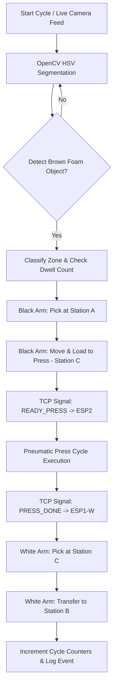

# Helix: Dual-Arm Pick-and-Place Control System

> A production-grade Python and ESP32 control system coordinating **two 5-DOF robotic arms** (Black Arm and White Arm) and an automated **pneumatic press machine** in a closed-loop manufacturing pipeline with computer vision tracking, non-blocking TCP socket communication, and real-time GUI telemetry.

---

## 1. Project Overview

**Helix** is a complete industrial-style automation pipeline designed to coordinate multiple robotic arms and auxiliary manufacturing machinery. The system solves the problem of synchronizing multi-stage mechanical assembly processes (raw material retrieval, press forming, and finished goods transfer) while ensuring safety, non-blocking operation, and visual cycle tracking.

### Core Architecture
- **Black Arm (ESP1-B)**: Responsible for picking raw material (brown dye/foam blocks) from **Station A** and loading them onto the **Press Bed (Station C)**.
- **Press Machine (ESP2)**: A pneumatic press triggered over TCP sockets to execute press operations on materials placed at Station C.
- **White Arm (ESP1-W)**: Responsible for retrieving processed materials from **Station C** once pressing completes and transferring them to **Station B** (Finished Goods).
- **Vision Engine**: Real-time OpenCV pipeline providing HSV color space segmentation, spatial zone classification, and cycle dwell verification.

---

## 2. System Workflow



### Execution Sequence
1. **Camera Ingestion**: Real-time VideoCapture ingests frames from a USB webcam or Microsoft Kinect RGB sensor.
2. **Vision Processing**: OpenCV filters frames using HSV bounds (`DYE_LOWER`, `DYE_UPPER`) to identify brown foam objects.
3. **Zone Classification**: The object's centroid is checked against 2D camera pixel regions (`Zone A`, `Zone C`, `Zone B`). A 10-frame dwell threshold confirms spatial stability.
4. **Stage 1 (Black Arm Pick & Load)**: Black Arm executes motion trajectory from Station A $\rightarrow$ Station C.
5. **Stage 2 (Pneumatic Press Handshake)**: Black Arm ESP1-B transmits `READY_PRESS` over TCP port 9999 to Press ESP2. ESP2 actuates solenoids and returns `PRESS_DONE`.
6. **Stage 3 (White Arm Retrieval & Offload)**: Press ESP2 sends `PICK_READY` to White Arm ESP1-W (port 8889). White Arm moves from Station C $\rightarrow$ Station B.
7. **Telemetry & Logging**: The system updates cycle metrics (`pick_count`, `press_count`, `cycle_count`) and logs timestamped events to the GUI listbox.

---

## 3. Key Functionalities

- **Computer Vision Tracking**: HSV color segmentation with morphological filtering (erosion/dilation) and contour area thresholding.
- **Spatial Zone Dwell Logic**: Require stable detection across consecutive frames (`ZONE_DWELL_FRAMES = 10`) before triggering state transitions.
- **Multi-Node Socket Coordination**: Threaded TCP socket client (`ESPComms`) for non-blocking network communication across microcontrollers.
- **Custom Hardware Control**: 6-channel PWM servo angle constraints, software limit safety checks, and homing routines.
- **Station Pose Management**: JSON-backed persistence (`stations_black.json`, `stations_white.json`) for 6-DOF arm poses (`above` and `pick`).
- **Live GUI Telemetry**: Built with Tkinter, offering real-time camera overlays, joint sliders, manual jog controls, connection status indicators, and event logs.

---

## 4. Computer Vision Pipeline

```
Raw Camera Frame (BGR)
       │
       ▼
  cv2.cvtColor (HSV Space)
       │
       ▼
  cv2.inRange (DYE_LOWER to DYE_UPPER)
       │
       ▼
  Erosion (2 iter) & Dilation (3 iter)
       │
       ▼
  cv2.findContours & max(contourArea)
       │
       ▼
  Min Enclosing Circle -> (cx, cy), radius
       │
       ▼
  Zone Point-in-Polygon Check & Dwell Count
```

### Current Detection Parameters
- **Target Object**: Brown dye / brown foam blocks.
- **HSV Lower Bounds**: `H: 5, S: 50, V: 50`
- **HSV Upper Bounds**: `H: 20, S: 255, V: 200`
- **Minimum Object Radius**: `12 pixels`
- **Dwell Threshold**: `10 consecutive frames`

---

## 5. Vision Zones (`zones_black.json` & `zones_white.json`)

The vision system divides the camera coordinate space (640×480) into three logical operational zones stored in JSON files:

| Zone File | Zone | Camera Coordinates `[x1, y1, x2, y2]` | Description |
| :--- | :---: | :---: | :--- |
| `zones_black.json` | **Zone A** | `[471, 172, 639, 308]` | Raw Material Pickup Tray |
| `zones_black.json` / `zones_white.json` | **Zone C** | `[245, 41, 435, 284]` | Pneumatic Press Bed |
| `zones_white.json` | **Zone B** | `[1, 192, 195, 345]` | Finished Goods Dropoff Tray |

---

## 6. Robot Stations (`stations_black.json` & `stations_white.json`)

Robot poses are defined as 6-element joint arrays: `[base, shoulder, elbow, wrist_rot, wrist_pitch, gripper]`.

### Black Arm Stations (`stations_black.json`)
```json
{
  "A": {
    "above": [70, 131, 27, 90, 159, 40],
    "pick":  [70, 143, 102, 90, 109, 10]
  },
  "C": {
    "above": [180, 131, 27, 90, 159, 40],
    "pick":  [180, 153, 76, 90, 136, 10]
  }
}
```

### White Arm Stations (`stations_white.json`)
```json
{
  "C": {
    "above": [0, 98, 0, 90, 25, 60],
    "pick":  [0, 141, 89, 90, 69, 10]
  },
  "B": {
    "above": [100, 98, 0, 90, 25, 60],
    "pick":  [100, 129, 71, 77, 56, 10]
  }
}
```

---

## 7. Software Architecture

```
helix/
├── LICENSE
├── README.md
├── requirements.txt
├── main.py                   # Application entry point
├── gui.py                    # Tkinter GUI, telemetry & canvas rendering
├── motion_loop.py            # Coordinated multi-arm state machine
├── camera.py                 # OpenCV vision tracking & zone classification
├── config.py                 # System parameters, HSV bounds & network IPs
├── esp_comms.py              # Threaded TCP socket client for ESP32 nodes
├── servos.py                 # Servo PWM pulse calculation & constraint checks
├── stations.py               # JSON station pose persistence manager
├── transport.py              # Pneumatic press & conveyor transport interface
├── calibrate_dye_color.py    # Developer HSV tuning tool (OpenCV trackbars)
├── stations_black.json       # Black Arm target joint poses
├── stations_white.json       # White Arm target joint poses
├── zones_black.json          # Black Arm camera region coordinates
├── zones_white.json          # White Arm camera region coordinates
├── esp_black_arm/
│   └── wifi_stream/          # ESP32 Black Arm Arduino firmware & Wi-Fi config
├── esp_white_arm/
│   └── wifi_stream/          # ESP32 White Arm Arduino firmware & Wi-Fi config
└── esp_press/
    └── wifi_press/           # ESP32 Press Machine Arduino firmware & Wi-Fi config
```

### Module Responsibilities

- `main.py`: Initializes `AppWindow` and starts the main application loop.
- `gui.py`: Manages the user interface, arm panels (`black_panel`, `white_panel`), live video feed, event log listbox, and manual controls.
- `motion_loop.py`: Runs automated pick, press, and place routines in a background thread without freezing the UI.
- `camera.py`: Encapsulates OpenCV frame processing, HSV masking, contour detection, zone dwell tracking, and overlay drawing.
- `config.py`: Central repository for network settings, servo limits, station defaults, and color thresholds.
- `esp_comms.py`: Handles raw TCP socket connections, reconnection timeouts, and handshake framing.
- `servos.py`: Converts joint angles to PWM duty cycles and validates movements against min/max limits.
- `stations.py`: Loads, validates, migrates, and saves pose definitions in JSON format.
- `transport.py`: Controls transport timing and press dwell intervals.
- `calibrate_dye_color.py`: Developer utility for interactive HSV trackbar calibration.

---

## 8. Hardware Components

- **Robotic Arms**: Two 5-DOF articulated arms + end-effector grippers (Black Arm & White Arm).
- **Microcontrollers**: Three ESP32 development boards (ESP1-B, ESP1-W, ESP2).
- **Actuators**: PWM servo motors driving arm joints and grippers.
- **Auxiliary Machinery**: Pneumatic press solenoid assembly.
- **Vision Sensors**: Standard USB webcam (640×480 @ 30 FPS) or Microsoft Kinect v1 RGB camera.

---

## 9. Communication Architecture

The system uses standard Wi-Fi TCP/IP socket streams:

| Node | Role | IP Address | TCP Port | Protocol Messages |
| :--- | :--- | :--- | :---: | :--- |
| **PC Host** | Master GUI & Vision Engine | DHCP / Static | Variable | Serves control commands to ESP nodes |
| **ESP1-B** | Black Arm Controller | `192.168.0.128` | `8888` | Receives servo arrays `[S0..S5]`, sends `READY_PRESS` |
| **ESP1-W** | White Arm Controller | `192.168.0.129` | `8889` | Receives servo arrays `[S0..S5]`, receives `PICK_READY` |
| **ESP2** | Press Solenoid Controller | `192.168.0.130` | `9999` | Receives `READY_PRESS`, transmits `PRESS_DONE` |

---

## 10. Graphical User Interface

The GUI provides three main tabs:
1. **Black Arm Control**: Servo position sliders, homing controls, IP binding settings, and station pose editor.
2. **White Arm Control**: Independent manual joint sliders, homing routines, and station editor.
3. **Live Camera Feed**: Real-time video canvas with interactive zone bounding boxes, FPS monitor, detection status overlays, and event history log.

---

## 11. Configuration Settings (`config.py`)

Key parameters defined in `config.py`:

```python
# Network Ports
BLACK_WIFI_PORT = 8888
WHITE_WIFI_PORT = 8889
ESP2_PORT       = 9999

# Color Segmentation (Brown Dye / Foam)
DYE_LOWER = (5, 50, 50)
DYE_UPPER = (20, 255, 200)

# Dwell Verification
ZONE_DWELL_FRAMES = 10
MIN_DYE_RADIUS    = 12
```

---

## 12. Developer Calibration Utility

`calibrate_dye_color.py` is an optional interactive tuning tool.

```bash
python3 calibrate_dye_color.py
```

It creates 6 trackbars (`H_min`, `S_min`, `V_min`, `H_max`, `S_max`, `V_max`) and displays a live binary mask side-by-side with the BGR feed. When finished, press `q` to view suggested `DYE_LOWER` and `DYE_UPPER` tuples for `config.py`.

---

## 13. Installation & Setup

### Prerequisites
- Python 3.10+
- Arduino IDE with ESP32 Board Support package installed

### 1. Install Dependencies
```bash
pip install -r requirements.txt
```

### 2. Microcontroller Firmware Setup
Flash each ESP32 board using Arduino IDE from its respective subfolder:
- `esp_black_arm/wifi_stream/wifi_stream.ino`
- `esp_white_arm/wifi_stream/wifi_stream.ino`
- `esp_press/wifi_press/wifi_press.ino`

*Note: Update `esp_wifi_config.h` in each folder with your local Wi-Fi SSID and Password before flashing.*

---

## 14. How to Run

1. Connect ESP32 microcontrollers to your local Wi-Fi network.
2. Ensure your USB camera is connected.
3. Launch the application:
```bash
python3 main.py
```
4. In the GUI, connect to the Black Arm, White Arm, and Press nodes.
5. Click **START AUTOMATED CYCLE** to launch closed-loop operation.

---

## 15. Configuration Files Reference

| File | Purpose | Editable |
| :--- | :--- | :---: |
| `config.py` | Global TCP ports, IP defaults, servo limits, vision thresholds | Yes |
| `stations_black.json` | Black Arm Station A & C target joint poses | Yes (via GUI) |
| `stations_white.json` | White Arm Station C & B target joint poses | Yes (via GUI) |
| `zones_black.json` | 2D camera coordinates for pickup and press zones | Yes (via GUI Drag) |
| `zones_white.json` | 2D camera coordinates for press and dropoff zones | Yes (via GUI Drag) |

---

## 16. Hardware & Safety Operational Notes

> [!WARNING]
> **Pneumatic & Mechanical Safety Warning**
> - Robotic arms can move rapidly without warning during automated sequences.
> - Ensure all workspace clearance zones are free of obstacles and fingers.
> - The pneumatic press operates under mechanical pressure; keep hands clear of Station C during operation.

---

## 17. Troubleshooting Guide

- **Camera Feed Not Loading**: Verify camera index in `config.py` (`CAM_INDEX = 0`). Ensure no other application is using the webcam.
- **ESP32 Connection Refused**: Check local IP addresses assigned by router DHCP and update `config.py` (`BLACK_WIFI_IP`, `WHITE_WIFI_IP`, `ESP2_IP`).
- **Object Not Detected**: Run `calibrate_dye_color.py` under your current ambient lighting to tune HSV lower/upper bounds.
- **Arm Hitting Mechanical Limits**: Check servo bounds (`BLACK_SERVO_MIN`, `BLACK_SERVO_MAX`) in `config.py`.

---

## 18. Technologies Used

- **Python 3** (Core system logic & threading)
- **OpenCV & NumPy** (Computer vision & image processing)
- **Tkinter & Pillow** (Graphical user interface)
- **C++ / Arduino** (ESP32 microcontroller firmware)
- **TCP/IP Sockets** (Low-latency inter-device network messaging)
